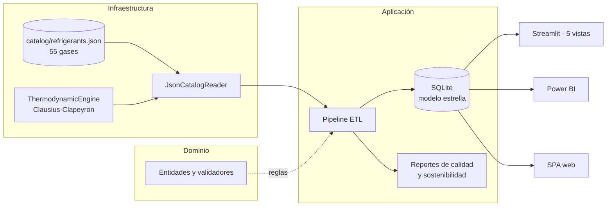

<p align="center"></p>

<h1 align="center">KrioMetrics</h1>

<p align="center"><b>A catalog of 55 refrigerants turned into analysis, comparison and interactive visualization.</b></p>

<p align="center"><a href="https://refrigerant-explorer.streamlit.app/"><b>Live demo ↗</b></a></p>

<p align="center"></p>

<p align="center">
    
</p>

<p align="center"><a href="https://dodysalim.github.io/"><b>🌐 Portfolio</b></a> · <a href="README.md"><b>🇪🇸 Versión en español</b></a></p>

---

## 📌 At a glance

| | |
| --- | --- |
| **🎯 Problem** | Compare properties, safety and environmental impact of refrigerant gases with explicit assumptions. |
| **🛠️ Solution** | ETL into a SQLite star schema with a layered architecture (domain, application, infrastructure, presentation). |
| **📈 Deliverables** | 5 Streamlit views (P-T calculator, comparator, refrigeration cycle, SQL console) and Power BI. |
| **🧪 Quality** | 59 automated tests; catalog stored as JSON, thermodynamic engine isolated from readers. |

## 🏗️ Architecture



## 🚀 How to run

```bash
python -m venv .venv && source .venv/bin/activate
pip install -r requirements.txt
python -m streamlit run dashboard.py
python -m pytest tests -q
```

## ⚖️ Scope

P-T curves are model estimates (calibrated Clausius-Clapeyron), not certified engineering tables.

---

<p align="center">
<b>Dody Dueñas Remache</b> · Data Analyst / Data Scientist · Guayaquil, Ecuador (remote LATAM)<br>
<a href="https://dodysalim.github.io/">Portfolio</a> · <a href="https://github.com/dodysalim">GitHub</a> · <a href="https://www.linkedin.com/in/dody-duenas/">LinkedIn</a> · <a href="mailto:dodydurema67@gmail.com">dodydurema67@gmail.com</a>
</p>
