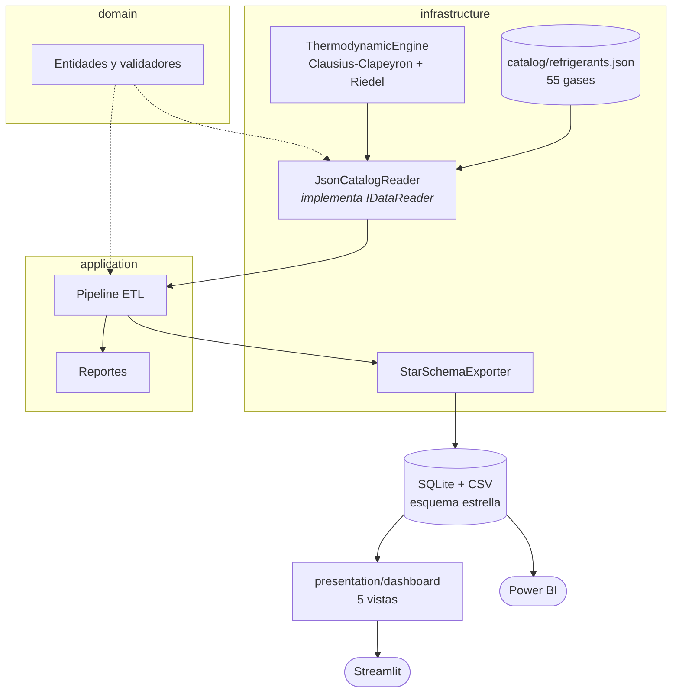

<p align="center"></p>

<h1 align="center">KrioMetrics</h1>

<p align="center"><b>Un catálogo de 55 refrigerantes convertido en análisis, comparación y visualización interactiva.</b></p>

<p align="center">

</p>

<p align="center">
    
</p>

<p align="center">
<a href="https://github.com/dodysalim/refrigerant-gas-dashboard/actions"></a>  
</p>

<p align="center"><a href="https://dodysalim.github.io/"><b>🌐 Portafolio</b></a> · <a href="docs/PORTFOLIO_CASE.md"><b>📄 Caso de estudio</b></a> · <a href="docs/VALIDATION.md"><b>✅ Verificación</b></a> · <a href="README.en.md"><b>🇺🇸 English</b></a></p>

---

## 📌 Resumen en 30 segundos

| | |
| --- | --- |
| **🎯 Problema** | Comparar propiedades, seguridad e impacto ambiental de gases refrigerantes con hipótesis claras. |
| **🛠️ Solución** | ETL y almacén SQLite con arquitectura por capas (dominio, aplicación, presentación). |
| **📈 Entregables** | 5 vistas Streamlit (cálculo, comparación, ciclo, consulta SQL) y Power BI con curvas y escenarios. |
| **🧪 Calidad** | 59 pruebas automatizadas; arquitectura por capas (dominio, aplicación, infraestructura, presentación). |
| **👤 Autor** | Dody Dueñas Remache. |

## ❓ La pregunta de negocio

¿Cómo comparar propiedades, seguridad e impacto ambiental manteniendo claras las hipótesis de los cálculos?

## ✨ Qué incluye

- ETL y almacén SQLite para gases y propiedades P-T.
- Cinco vistas de control, cálculo, comparación, ciclo y consulta SQL.
- Power BI con curvas, escenarios y tablas relacionadas.

## 🚀 Cómo ejecutarlo

Usa Python 3.11 o 3.12 en un entorno independiente. Desde la raíz:

```bash
python -m venv .venv
# Windows: .venv\Scripts\activate
# macOS/Linux: source .venv/bin/activate
python -m pip install -r requirements.txt
python -m pip install pytest
```

Después de configurar los datos:

```bash
python -m streamlit run dashboard.py
```

## 🗂️ Datos y configuración

Datos incluidos: catálogo de 55 refrigerantes. El ciclo Power BI pide un solo gas y un escenario de temperaturas para evitar promediar condiciones físicas diferentes.

## 📊 Power BI · PC y móvil

[Archivos e instrucciones](powerbi/README.md). Descarga el repositorio completo y abre `powerbi/Abrir-PowerBI.bat` en Windows; después pulsa **Actualizar**. Incluye A4 horizontal a tamaño real (100 %) y diseño móvil vertical. El archivo `.pbip` necesita sus carpetas Report, SemanticModel y data.

## 🏗️ Arquitectura



## 🧭 Estructura del repositorio

| Ruta | Qué contiene |
| --- | --- |
| [src/domain/](src/domain/) | Entidades y reglas de dominio |
| [src/application/](src/application/) | Pipeline y reportes |
| [src/infrastructure/](src/infrastructure/) | Catálogo JSON, motor termodinámico y lectores intercambiables |
| [src/presentation/dashboard/](src/presentation/dashboard/) | Cinco vistas analíticas |
| [tests/](tests/) | Pruebas de dominio y sostenibilidad |

## ✅ Calidad y alcance

59 pruebas aprobadas; cinco vistas Streamlit probadas sin excepciones. KrioMetrics Power BI abrió con datos en el PC durante la entrega anterior.

Las curvas y ciclos son estimaciones del modelo usado en la aplicación, no tablas certificadas para ingeniería. La malla de ciclos de Power BI usa intervalos de 5 °C.

Para repetir las pruebas desde la raíz:

```bash
python -m pytest tests -q
```

## 👥 Autoría

Proyecto personal. Dody Salim Dueñas Remache.

[Documentación anterior](docs/ORIGINAL_README.md), conservada como referencia histórica.

---

<p align="center">
<b>Dody Dueñas Remache</b> · Analista de Datos / Data Scientist<br>
<a href="https://dodysalim.github.io/">Portafolio</a> · <a href="https://github.com/dodysalim">GitHub</a> · <a href="https://www.linkedin.com/in/dody-duenas/">LinkedIn</a> · <a href="mailto:dodydurema67@gmail.com">dodydurema67@gmail.com</a>
</p>
